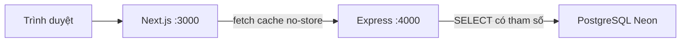
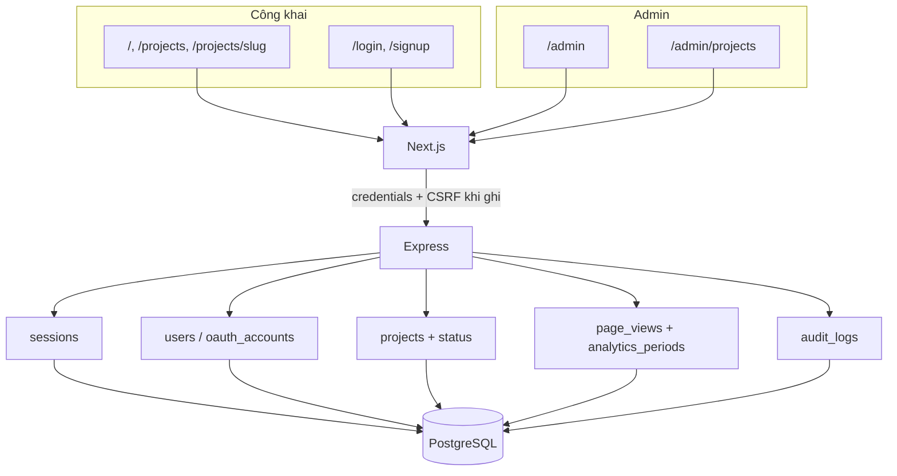

# Giới thiệu & kiến trúc tổng quan

Cập nhật: 2026-10-27

## Giới thiệu dự án

**fullstack-project** là portfolio cá nhân đang được mở rộng thành **Portfolio CMS** để học Frontend (Next.js), Backend (Node.js/Express) và PostgreSQL.

Chủ dự án: Lê. UI tiếng Việt (`lang="vi"`). Repo: [hoamiz/fullstack-project](https://github.com/hoamiz/fullstack-project).

Mục tiêu không chỉ là có code chạy được, mà hiểu luồng request, quyết định kiến trúc, bảo mật cơ bản và cách kiểm chứng.

Tài liệu liên quan:

- `CONTEXT.md` — trạng thái hiện tại, lệnh chạy
- `ROADMAP.md` — lịch Phase 1 và quyết định đã chốt
- `docs/learning/` — bài học từng ngày

## Kiến trúc hiện tại

Hai process tách nhau, không phải monorepo workspace:

| Lớp | Công nghệ | Vai trò |
| --- | --- | --- |
| Frontend | Next.js 16 App Router, React 19, TypeScript, Tailwind CSS 4 | Render trang; Server Component `fetch` tới API |
| Backend | Express 5 trong `apps/api`, `pg`, `tsx` | API JSON; đọc PostgreSQL |
| Database | Neon PostgreSQL 18 (Singapore) | Lưu bảng `projects` |

Trình duyệt **không** nối thẳng database. Next.js (server) gọi Express; Express mới chạy SQL có tham số (`$1`).



### Route public đang có

| Route | Nguồn dữ liệu |
| --- | --- |
| `/` | Trang giới thiệu |
| `/projects` | `GET /projects` |
| `/projects/[slug]` | `GET /projects/:slug` |
| slug lạ / draft | API 404 → `notFound()` |

API lỗi hoặc tắt → `app/projects/error.tsx` (nút Thử lại). Database lỗi → Express `503`.

### Dữ liệu project

- Bảng `projects`: slug, title, summary, description, stack, year, **status** (`draft` \| `published`).
- Public chỉ trả `status = 'published'` (Phase 1 Ngày 1).
- Ba slug mẫu: `next-notes`, `ui-lab`, `api-sketch`.
- Migration: `npm run db:migrate`. Không chạy lại seed khi đã có dữ liệu thật.

### Chưa có trên kiến trúc hiện tại

Auth, session, role, admin UI, analytics, tạo/sửa project qua UI, test tự động, CI/CD.

## Kiến trúc hướng tới

Giữ **Next.js (UI) + Express (nghiệp vụ + quyền) + PostgreSQL**. Auth và phân quyền nằm ở Express; UI không phải hàng rào duy nhất.



### Ba vùng sản phẩm

1. **Public** — xem portfolio và project đã publish. Guest không cần tài khoản.
2. **Đã đăng nhập** — email/mật khẩu (Argon2id) hoặc Google OIDC; session cookie `HttpOnly` do Express phát hành.
3. **Admin** — tạo project tối thiểu, publish/ẩn, xem analytics, reset mốc báo cáo. Mọi thao tác qua API có kiểm tra `role`.

### Quyết định đã chốt (Phase 1)

- Session: `express-session` + lưu PostgreSQL; cookie `HttpOnly`, `SameSite=Lax`, `Secure` chỉ khi HTTPS production.
- Validation: Zod ở UI và API; **API là nơi quyết định cuối**.
- Guest = không có session (không có dòng user guest).
- Admin đầu tiên: script local, không có API public nâng quyền.
- Phase 1 có **tạo** project (slug, title, description, draft/published) và publish/hide. Sửa/xóa/ảnh/rich text → Phase 2.

### Vì sao tách FE và API

Mục tiêu học là Node/Express và PostgreSQL. Nếu auth chỉ nằm trong Next (Server Action / Auth.js), Express dễ trống hoặc phải tin session phía Next — rủi ro hở quyền admin. Express giữ quyền; Next render và gọi API kèm credentials khi cần.

## Chạy local (tóm tắt)

```bash
npm run dev:fe      # http://localhost:3000
npm run dev:api     # http://localhost:4000
npm run db:migrate  # migration chưa áp dụng
```

Bí mật: `apps/api/.env` (`DATABASE_URL`, sau này thêm session/OAuth). Không commit `.env`.

## Ranh giới tài liệu này

File mô tả **tổng quan**. Chi tiết schema → `docs/database.md` (sẽ thêm khi schema ổn định hơn). Chi tiết auth → `docs/authentication.md`. Lịch học → `ROADMAP.md` và `docs/learning/`.
