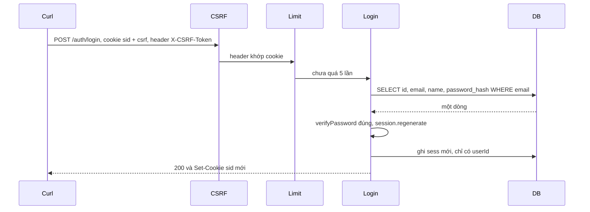

# Ngày 5 — Đăng nhập, đăng xuất, rate limit

Ngày 4 đã xong: trình duyệt giữ cookie `sid` và `csrf`, mọi `POST` thiếu hoặc sai `X-CSRF-Token` bị 403 trước route. `POST /auth/register` tạo user, hash Argon2id nằm trong `users.password_hash`. Chưa có cách nào gắn user đó vào session.

Hôm nay thêm đăng nhập và đăng xuất trên API. Trang `/login` vẫn chỉ là tiêu đề. Form sẽ làm ở Ngày 6. Mọi phép thử hôm nay dùng `curl` và cookie jar.

## 1. Mục tiêu

- `POST /auth/login` kiểm tra mật khẩu bằng `verifyPassword`, rồi lưu `userId` vào session.
- Email lạ và mật khẩu sai trả cùng status, cùng JSON.
- `POST /auth/logout` xóa session trên PostgreSQL và xóa cookie `sid`.
- Rate limit chặn dò mật khẩu trước khi chạy Argon2.

## 2. Thời lượng

6 giờ: 1 giờ lý thuyết, 3,5 giờ route và test, 1,5 giờ review.

## 3. Kiến thức cần có

Cookie và CSRF ở Ngày 4. `verifyPassword` và bảng `users` ở Ngày 2.

## 4. Bài này giải quyết gì

Đăng ký chỉ tạo một dòng `users`. Lần sau trình duyệt vẫn là khách, vì session chưa biết dòng đó là ai. Đăng nhập là bước tìm đúng dòng, kiểm tra mật khẩu, rồi ghi `userId` vào session hiện tại. Cookie `sid` vẫn chỉ là mã phiên. Role và `password_hash` không được nằm trong cột `sess`.

Hai trường hợp sai phải trông giống hệt nhau: email không có trong bảng, và email có nhưng mật khẩu sai. Cả hai trả **401** với đúng body `{ "error": "Email hoặc mật khẩu không đúng" }`. Nếu email lạ trả 404 hoặc câu «không tìm thấy user», người dò biết email nào đã đăng ký.

`session.regenerate` tạo một `sid` mới sau khi mật khẩu đúng, rồi mới gán `userId`. Không regenerate thì một kẻ đã nhét sẵn cookie `sid` vào trình duyệt nạn nhân sẽ chiếm session sau khi nạn nhân đăng nhập. Đó là session fixation.

Logout phải xóa dòng session trên server. Chỉ xóa cookie ở trình duyệt thì ai còn giữ giá trị `sid` cũ vẫn gửi lại được.

Rate limit đứng trước `verifyPassword`. Argon2 cố tình chậm. Vài trăm request song song sẽ chiếm CPU dù mật khẩu toàn sai. Ngưỡng của bài này: **5 request trong 15 phút** cho `POST /auth/login`, tính theo IP. Request đăng nhập thành công không tính vào ngưỡng (`skipSuccessfulRequests: true`). Vượt ngưỡng trả **429** và JSON `{ "error": "Bạn thử đăng nhập quá nhiều lần. Đợi một lát rồi thử lại." }`. Bộ đếm nằm trong RAM của process API. Restart API là bộ đếm về 0. Đủ cho máy local. Chưa cần Redis.

Login và logout là mutation, nên middleware CSRF Ngày 4 chạy trước. Thiếu header thì 403, chưa tới rate limit và chưa tới Argon2.

## 5. Luồng một lần đăng nhập đúng



`GET` để lấy cookie không bị CSRF chặn. `POST` không có header dừng ở CSRF.

## Hướng dẫn làm

Bạn tự viết. Cài package trong `apps/api`, không cài ở root repo.

### Bước 1. Cài rate limit

Trong `apps/api`:

```bash
npm install express-rate-limit
```

Mục đích: có middleware đếm request trước handler login. Sau đó chạy `npm run typecheck` trong `apps/api`.

### Bước 2. Tìm user để kiểm tra mật khẩu

Trong `apps/api/src/users.ts`, thêm một hàm chỉ phục vụ login. Câu SQL là:

```sql
SELECT id, email, name, password_hash
FROM users
WHERE email = $1
```

`$1` là email đã `trim` và `toLowerCase` từ Zod, cùng cách `addUser` đang lưu. Hàm trả về dòng hoặc `null`. Không `SELECT *`. Không `console.log` cả dòng, vì dòng có hash.

File này đã import `pool` từ `./db.js`. Hàm mới dùng lại pool đó.

### Bước 3. Khai báo `userId` trên session

`server.ts` đã có `declare module "express-session"` với `csrfToken`. Thêm `userId?: string` cạnh đó. Đây chỉ là kiểu TypeScript. Lúc chạy, session vẫn là JSON trong cột `sess`.

Không thêm `role` và không thêm `password_hash` vào interface này. Role sẽ được đọc từ bảng `users` mỗi lần cần, bắt đầu từ Ngày 6.

### Bước 4. Schema Zod cho login

Trong `apps/api/src/routes/auth.ts`, tạo schema riêng, không tái dùng rule độ dài mật khẩu của đăng ký.

Email dùng cùng kiểu form đăng ký đang có: `z.string().trim().email().toLowerCase()`. Mật khẩu là `z.string().min(1)`.

Lý do không dùng rule «ít nhất 12 ký tự» lúc login: một mật khẩu gõ thiếu ký tự sẽ thành 400, còn mật khẩu đủ dài nhưng sai thành 401. Người dò nhìn status là biết mật khẩu ngắn hay dài. Body sai cú pháp vẫn 400. Body đúng cú pháp nhưng không khớp database thì mới 401.

### Bước 5. `POST /auth/login`

Thứ tự trong handler:

1. `safeParse`. Thất bại thì 400 và JSON lỗi Zod, giống register. Dừng.
2. `findUser` bằng email đã chuẩn hóa.
3. Nếu không có dòng, hoặc `password_hash` là `null`, vẫn gọi `verifyPassword` với một hash Argon2 giả, bỏ kết quả, rồi trả 401 cùng câu với trường hợp sai mật khẩu. Hash giả tạo một lần khi file được load, bằng `hash` từ `@node-rs/argon2`, không lấy từ request. Mục đích là thời gian trả lời không ngắn hơn hẳn khi email không tồn tại.
4. Nếu có hash thật, `verifyPassword(password, password_hash)`. Hàm này đã có trong `apps/api/src/password.ts`. Kết quả `false`, hoặc hàm ném lỗi, thì 401 cùng body. `console.error` được, nhưng không log mật khẩu và không log hash.
5. Mật khẩu đúng thì sang bước 5.5. Chưa gửi response ở bước này.

Body 401, đúng từng ký tự, dùng cho cả email lạ và mật khẩu sai:

```json
{ "error": "Email hoặc mật khẩu không đúng" }
```

### Bước 5.5. Tạo phiên mới rồi mới trả 200

`regenerate` và `save` của `express-session` không trả về Promise. Chúng nhận callback và trả về ngay lập tức. Dòng viết bên dưới `regenerate(...)` chạy trước khi phiên mới tồn tại.

Trong `apps/api/src/routes/auth.ts`, chỗ mật khẩu đã đúng, thứ tự bắt buộc là bốn việc sau.

Việc một: chờ `regenerate` xong. Hàm này bảo store xóa session id cũ và phát một id mới. Callback chạy thì `req.session` mới là phiên trống. Gán `userId` trước lời gọi này thì giá trị đó nằm trên phiên sắp bị hủy, phiên mới không có `userId`, và login trông như thành công nhưng request sau vẫn là khách.

Việc hai: gán `req.session.userId` bằng `id` lấy từ dòng user. Không gán `role`. Không gán `password_hash`. Không gán cả object user.

Việc ba: chờ `save` xong. `save` ghi JSON phiên mới vào cột `sess` của bảng `session`. Ghi xong thì dòng mới đã có trong PostgreSQL.

Việc bốn: lúc này mới `res.status(200).json({ id, email, name })`. Ba field này lấy từ kết quả đã kiểm tra, không gửi nguyên cả dòng `SELECT`, vì dòng đó có `password_hash`.

Gọi `req.session.save()` ở dòng ngay sau `regenerate(...)`, bên ngoài callback, là lưu phiên cũ trong lúc phiên mới chưa được tạo. Hai việc chạy đua. Cookie trả về có thể là id mới, còn bảng `session` chưa có `userId`.

Gửi `res.json` bên trong callback của `regenerate` nhưng trước khi `save` xong cũng sớm. Trình duyệt nhận `Set-Cookie` rồi gửi request tiếp theo, trong khi `INSERT` phiên mới chưa commit.

Bọc callback thành Promise để `await` đúng thứ tự:

```ts
function regenerateSession(req: Express.Request) {
  return new Promise<void>((resolve, reject) => {
    req.session.regenerate((error) => {
      if (error) {
        reject(error);
        return;
      }
      resolve();
    });
  });
}

function saveSession(req: Express.Request) {
  return new Promise<void>((resolve, reject) => {
    req.session.save((error) => {
      if (error) {
        reject(error);
        return;
      }
      resolve();
    });
  });
}
```

Hai hàm này có thể nằm cuối `routes/auth.ts`. `Express.Request` lấy từ `import type { Request } from "express"` nếu không muốn ghi `Express.Request`. Trong handler login, sau khi mật khẩu đúng:

```ts
await regenerateSession(req);
req.session.userId = data.id;
await saveSession(req);
res.status(200).json({
  id: data.id,
  email: data.email,
  name: data.name,
});
```

`data` ở đây chỉ cần có `id`, `email`, `name`. Nếu `findUser` trả thêm field khác, không đưa field đó vào `json`.

Lỗi của `regenerate` hoặc `save` thì không trả 200. Để lỗi rơi xuống `handleError` hiện có trong `server.ts`, hoặc `catch` trong handler và trả 503. Không trả 200 kèm `userId` khi phiên chưa ghi được.

Sau response, header `Set-Cookie` có tên `sid` và một giá trị khác với `sid` gửi lên. Trong Neon, `sess` của sid mới có `userId`, không có `password_hash`, không có `role`. Sid cũ không còn dòng, hoặc còn dòng cũng không được dùng nữa vì trình duyệt đã giữ sid mới.

### Bước 6. Rate limit chỉ cho login

Đặt limiter làm middleware của riêng `authRouter.post("/login", limiter, handler)`. Không gắn lên cả app, nếu không `GET /projects` cũng bị đếm.

```ts
const loginLimiter = rateLimit({
  windowMs: 15 * 60 * 1000,
  limit: 5,
  skipSuccessfulRequests: true,
  standardHeaders: true,
  legacyHeaders: false,
  handler: (_req, res) => {
    res.status(429).json({
      error: "Bạn thử đăng nhập quá nhiều lần. Đợi một lát rồi thử lại.",
    });
  },
});
```

CSRF đã là middleware toàn cục, đứng trước router `/auth`. Một request login đi qua CORS, session, CSRF, rồi mới tới limiter, rồi mới tới handler. 403 CSRF không làm tăng ngưỡng. 429 xảy ra trước Argon2.

Nếu TypeScript báo không có option `limit`, bản `express-rate-limit` vừa cài đang dùng tên `max`. Đổi tên option cho khớp bản đó, giữ số 5 và 15 phút.

### Bước 7. `POST /auth/logout`

Handler không đọc body. `session.destroy`. Trong callback thành công, `clearCookie("sid", { path: "/", httpOnly: true, sameSite: "lax", secure: process.env.NODE_ENV === "production" })`, rồi `204`.

Tên cookie phải là `sid`, trùng `name` trong `server.ts`. Xóa nhầm tên `connect.sid` thì trình duyệt vẫn giữ phiên.

Không có session cũng trả 204. Logout lặp lại không phải lỗi.

### Bước 8. Chứng minh bằng curl

API đang chạy ở cổng 4000. Từ một thư mục tạm, không commit file cookie.

Lấy cookie:

```bash
curl -c cookies.txt http://localhost:4000/projects
```

Đọc giá trị `csrf` trong file. Gửi login. Thay email và mật khẩu bằng một user đăng ký thật:

```bash
curl -b cookies.txt -c cookies.txt -D - -X POST http://localhost:4000/auth/login \
  -H "Content-Type: application/json" \
  -H "X-CSRF-Token: <giá trị csrf>" \
  -d "{\"email\":\"ban@example.com\",\"password\":\"mat-khau-dung-12\"}"
```

Kỳ vọng: **200**, `Set-Cookie` tên `sid`, body không có hash. Trong Neon, `SELECT sess FROM session` của phiên mới có `userId`, không có `password_hash`, không có `role`.

Cùng lệnh với mật khẩu sai: **401** và đúng câu ở bước 5. Đổi email thành một địa chỉ chưa từng đăng ký: cùng **401**, cùng JSON. `count(*)` của `users` không tăng.

Gửi login không có header CSRF: **403**, câu CSRF Ngày 4, không phải 401.

Lần logout dùng cookie jar sau login, vẫn header CSRF:

```bash
curl -b cookies.txt -c cookies.txt -D - -X POST http://localhost:4000/auth/logout \
  -H "X-CSRF-Token: <giá trị csrf>"
```

Kỳ vọng **204**. Gửi lại `POST /auth/login` không cần. Việc cần thấy: request sau dùng `sid` cũ không còn `userId`. Ngày 6 mới có `GET /auth/me`. Hôm nay kiểm tra bằng SQL: dòng `sid` cũ không còn, hoặc `POST` một route sẽ làm ở Ngày 7. Tối thiểu, `SELECT` theo `sid` cũ không còn dòng.

Rate limit: gửi sai mật khẩu 6 lần trong 15 phút. Lần thứ 6 là **429** với câu ở bước 6. Ghi số 5 và 15 phút vào mục 14. Restart API nếu cần xóa bộ đếm để thử tiếp.

`npm run typecheck` trong `apps/api` phải thoát 0.

Không sửa `app/login/page.tsx` hôm nay. Form `/signup` vẫn 403 nếu bấm trên trình duyệt, vì nó chưa gửi cookie và header. Đó là việc Ngày 6. Curl của hôm nay tự gửi hai thứ đó.

## Cách đọc mục 6–9

Quy ước: [README.md](README.md#cách-đọc-mục-69).

---

## 6. Việc cần làm (phân công học)

**Bạn:** viết route và tự chạy hai case 401. **AI:** không viết hộ, trừ khi bạn nói «hãy code» hoặc chỉ một lỗi cụ thể.

### Task checklist — mục 6

- [x] Tự giải thích vì sao không trả 404 khi email lạ.
- [x] Tự nói được `regenerate` tránh session fixation.

---

## 7. Frontend (Next.js)

Chưa có trang login. UI là Ngày 6. Hôm nay không sửa `app/signup/signup-form.tsx`.

---

## 8. Backend (Express API)

Thứ tự một request login: CORS, session, CSRF, rate limit, handler. SQL chỉ lấy `id`, `email`, `name`, `password_hash`.

### Task checklist — Backend

- [x] Đúng mật khẩu → 200 và `Set-Cookie` tên `sid`.
- [x] Sai mật khẩu và email không có → cùng 401, cùng JSON.
- [x] Logout xóa session phía server và cookie `sid`.
- [x] Lần thứ 6 trong 15 phút → 429.
- [x] Không log mật khẩu hay hash.
- [x] Typecheck pass.

---

## 9. PostgreSQL

Một `SELECT` theo email. Sau logout, `sid` cũ không còn dùng được.

### Task checklist — PostgreSQL

- [x] `sess` sau login có `userId`, không có hash, không có role.
- [x] Sau logout, cookie `sid` cũ không còn gắn với user.

---

## 10. Kiểm tra

### Task checklist — Kiểm tra tổng

- [x] Các case mục 8 đã chứng minh bằng curl.
- [x] Ghi mục 14, kèm ngưỡng 5 request / 15 phút.

## 11. Checklist tổng

- [x] Mục 6–10 đạt.
- [x] Một thông báo lỗi chung khi login sai: `Email hoặc mật khẩu không đúng`.

## 12. Câu hỏi ôn

1. Vì sao 401 chứ không 404 khi email lạ?
2. `session.destroy` trên server khác việc xóa cookie ở trình duyệt chỗ nào?
3. Đặt rate limit sau `verifyPassword` thì còn yếu thế nào?

## 13. Lỗi hay gặp

- JSON kiểu «user not found» cho email lạ.
- So sánh mật khẩu bằng `===` với chuỗi hash.
- Gán `userId` trước `regenerate`, session mới thành trống.
- Quên header CSRF nên nhận 403 và tưởng mật khẩu sai.

## 14. Báo cáo hoàn thành

Review mentor: 2026-11-04, lần 5. Ngày 5 **đạt đủ**.

- Đã sửa file: `apps/api/src/routes/auth.ts`, `apps/api/src/users.ts`, `apps/api/src/server.ts` (`userId` trên session), `apps/api/package.json` (`express-rate-limit`). UI không đổi.
- Lệnh đã chạy và kết quả:
  - `npm run typecheck` trong `apps/api`: thoát 0.
  - Đăng ký một user thử bằng curl có CSRF: **201**.
  - `npm run typecheck` trong `apps/api`: thoát 0.
  - Đăng ký user thử: **201**. Login đúng mật khẩu: **200**, body chỉ `id`, `email`, `name`, có `Set-Cookie` tên `sid`.
  - `sess` của phiên đó có `cookie` và `userId`. Không có `password_hash`, không có `role`.
  - Mật khẩu sai và email không có: cùng **401**, cùng câu `Email hoặc mật khẩu không đúng`.
  - Logout: **204**, cookie `sid` mất, dòng `session` của sid đó còn **0**.
  - Rate limit: **429** sau 5 request / 15 phút.
  - Câu ôn: không trả 404 vì email lạ và mật khẩu sai phải giống nhau. Bỏ `regenerate` thì người giữ `sid` cũ chiếm phiên. `destroy` xóa phiên trên server. Rate limit sau `verifyPassword` thì mỗi request vẫn chạy Argon2 rồi mới bị 429.
- Body 401 dùng chung: `Email hoặc mật khẩu không đúng`. Ngưỡng rate limit: 5 request / 15 phút, request thành công không tính.
- Chưa xong:

## 15. Ngày kế

Ngày 6: trang `/login`, helper gửi cookie và CSRF, session còn sau khi tải lại, hết hạn thì ra khỏi trang bảo vệ.
